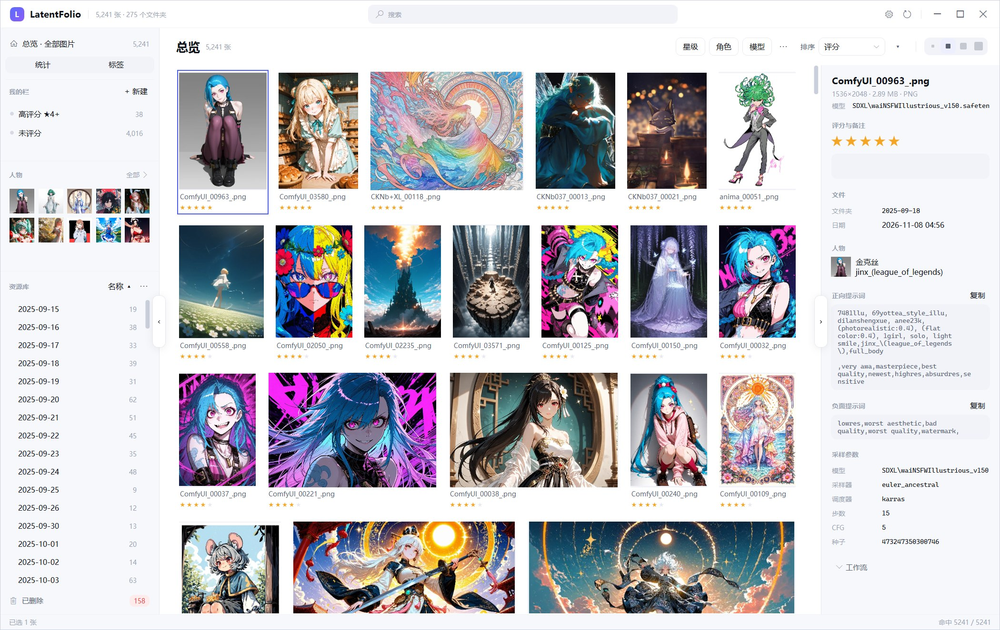
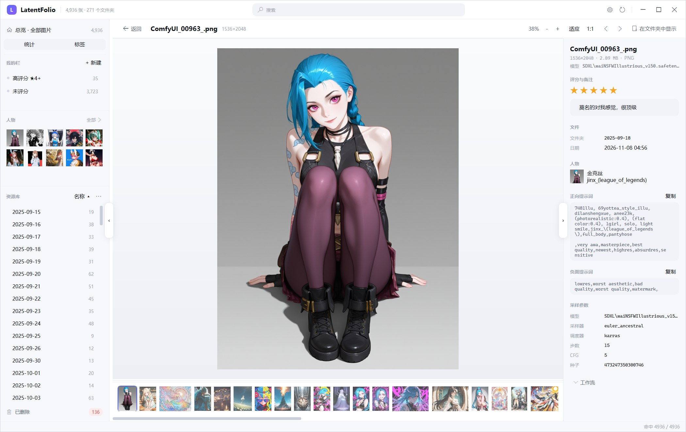
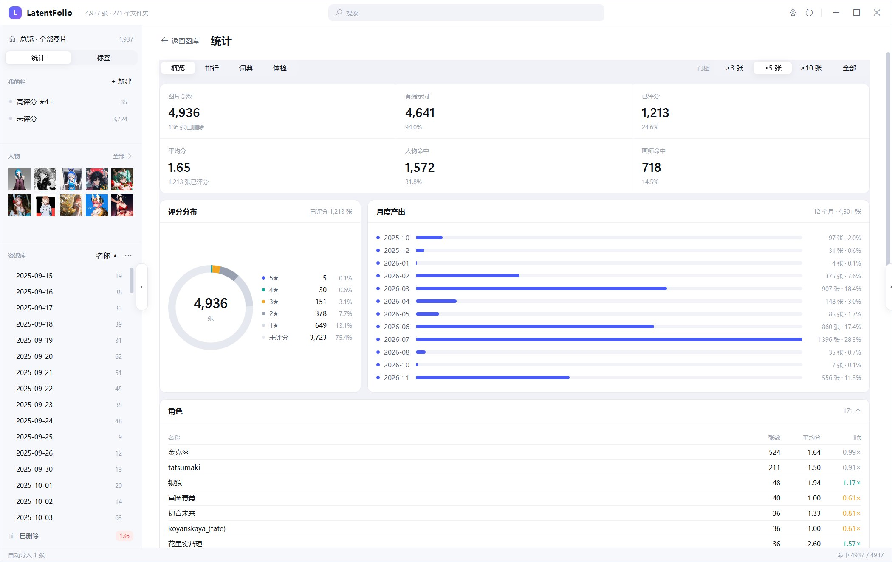

# LatentFolio

ComfyUI 出图的本地图库：自动入库，按人物、标签、评分和提示词检索，全程离线。


[功能](#功能) · [快速开始](#快速开始) · [常用操作](#常用操作) · [界面](#界面) · [实测](#实测) · [文档](#文档)



## 概览

LatentFolio 以 `ComfyUI/output` 为数据源：扫描每张 PNG 里嵌入的提示词与工作流，
连同评分、备注和删除状态一起存进本地 SQLite。几千张图的浏览、筛选和打开都在同一个窗口里完成。

不联网，不需要账号，也不会改动 `output` 里的任何文件。

## 功能

- **自动入库** — 目录监视常开，ComfyUI 出图落盘即进索引；内容相同的图只保留一份。
- **提示词解析** — 从采样器反向追踪正负提示词，识别角色、画师、模型和采样参数；约 95% 的图能拿到正向词。23 万角色 / 39 万画师 / 2 万通用词 / 2.6 万作品。
- **快速检索** — 顶部搜索覆盖提示词与文件名；星级、角色、模型三个下拉只列当前结果里出现过的项，点一下即筛选。
- **自定义栏目** — 22 个字段的布尔条件树，可存成多条「我的栏」，带命中计数和实时预览。
- **大库流畅** — 自写的等高虚拟化网格，只实例化视口内的格子；4,900 张刷新一次 1–3 ms。
- **查看器** — 双击进入：滚轮切换、Ctrl+滚缩放、1:1、底部胶片条，可选 RTX VSR：放大 / 降噪 / 锐化 / 高清放大 / 直播五组模型，各四档强度。
- **可还原的删除** — 文件消失或被删只改状态，评分、备注、标签都保留，随时还原。
- **托盘常驻** — 点关闭只是收到托盘，图标点回来继续；托盘菜单里退出。

## 快速开始

Windows 10 1809+ / 11（x64）。

预编译版本见 [Releases](https://github.com/SDU-YueQiu/LatentFolio/releases/latest)：win-x64 免安装包（67 MB，自带 .NET 运行时），解压后双击 `LatentFolio.exe` 即可。

从源码构建（需要 .NET 10 SDK）：

```powershell
git clone https://github.com/SDU-YueQiu/LatentFolio.git
cd LatentFolio
dotnet build LatentFolio.slnx -c Release
.\src\LatentFolio.App\bin\Release\net10.0-windows\LatentFolio.exe
```

构建完成后也可以双击仓库根目录的 `LatentFolio.lnk` 启动。

首次启动选择一次 `ComfyUI/output`（找不到时会尝试常见路径），之后自动扫描。
索引与缩略图位于 `%LOCALAPPDATA%\LatentFolio`，删除该目录即重置。

## 常用操作

| 我想 | 操作 |
| --- | --- |
| 看某天出的图 | 左栏「资源库」→ 日期 |
| 找某个角色 | 顶部搜索，或左栏「人物」、人物墙 |
| 只看四星以上 | 星级筛选，或新建一条「评分 ≥ 4」的栏 |
| 查看提示词、种子、工作流 | 选中图片，右侧详情栏 |
| 放大看细节 | 双击进入查看器 |
| 恢复误删的图 | 「已删除」→ 还原 |

## 界面

| 查看器 | 统计 |
| --- | --- |
|  |  |

## 实测

本机约 4,900 张 / 271 个目录：

| 指标 | 结果 |
| --- | --- |
| 冷启动到可交互 | 1.6 s |
| 全量读库 | 43–70 ms |
| 刷新网格 | 1–3 ms |
| 提示词解析率 | 94.0% |
| 内置自检 | 153 条 |

`--bench 50000` 会在临时目录生成 5 万张合成图（不触碰真实图库），Core 侧结果：

```
合成 50,000 张
落库          2316 ms
全量读入       423 ms
三条件筛选      16 ms  -> 12,339 张
排序             4 ms
相似分组        97 ms  -> 0 组 / 0 张
```

滚动与筛选的开销只与屏幕上的格子数有关，与图库总量无关。

## 范围

- 仅支持 Windows：WPF + SkiaSharp，没有跨平台计划。
- 不联网：无账号、无云同步，不上传图片。
- 只读 `output`：不内置模型，不参与生成。
- 不提供多选批量改备注；库内已有的重复图不会自动清理。

## 文档

- [架构与实现](docs/architecture.md) — 提示词解析、数据模型、缩略图、虚拟化、VSR
- [设计语言](docs/design-language.md) — 配色、字阶、圆角、间距
- [历史笔记](docs/legacy/) — 需求规格、页面设计、逆向分析

<details>
<summary>开发与自检</summary>

```powershell
.\tools\link-release.ps1        # 编译 Release + 更新根目录快捷方式
LatentFolio.exe --self-test     # 153 条交互回归，不抢前台，结果写 %TEMP%\lf-selftest.txt
```

三个工程：`LatentFolio.Core`（解析 / 扫描 / 筛选，无 UI 依赖）、`LatentFolio.App`（WPF）、`LatentFolio.Vsr`（P/Invoke NVIDIA Video Effects）。

</details>

## 许可

[MIT](LICENSE) © 2026 SDU-YueQiu
